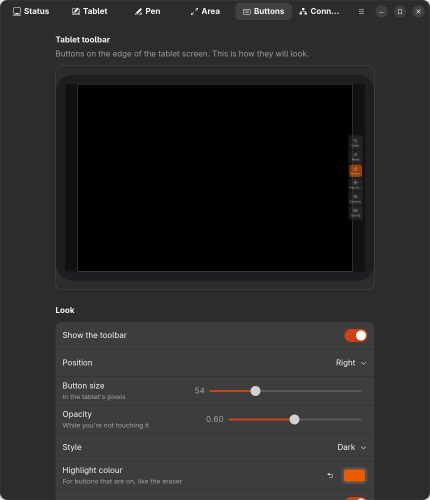
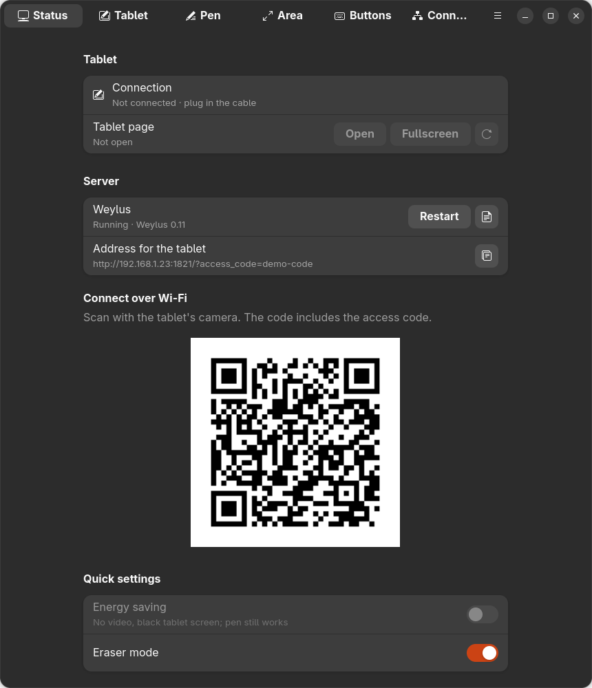
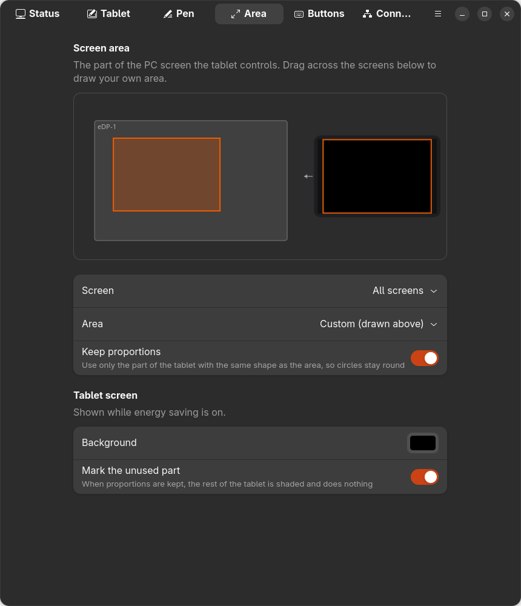
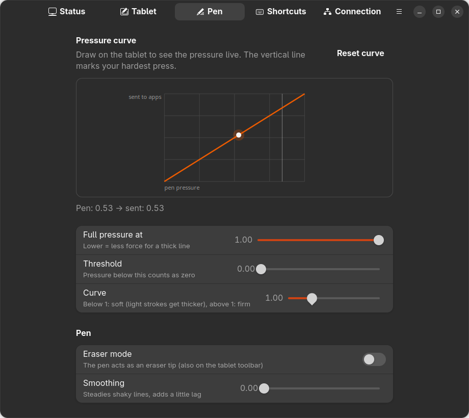
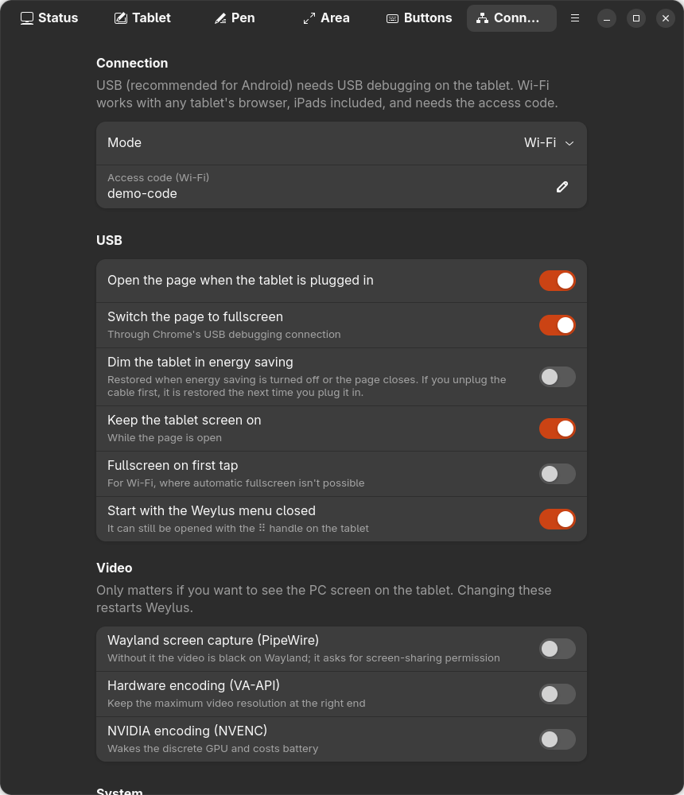

# Inkslate

[](https://github.com/melihcimen/inkslate/releases/latest)
[](https://github.com/melihcimen/inkslate/releases)
[](https://github.com/melihcimen/inkslate/stargazers)
[](LICENSE)

**A friendlier front end for Weylus: use an Android tablet or an iPad as a pen tablet for your
Linux PC, with any drawing app.**

[Weylus](https://github.com/H-M-H/Weylus) turns a tablet's web browser into a pen, touch and video
client for your PC; no app needs to be installed on the tablet. Inkslate runs Weylus in the
background and adds what you need to use it every day: plug-and-draw over USB, a pressure curve,
an eraser, a customizable toolbar on the tablet, screen areas and a desktop window that controls
all of it.

It works with the official Weylus 0.11.4 release and with
[Weylus Community Edition](https://github.com/electronstudio/WeylusCommunityEdition) (a binary or
the Flatpak from Flathub), and with any app that understands a pen tablet: Krita, GIMP, Inkscape,
Xournal++, Rnote, Blender, OpenBoard, MyPaint, Pinta…



## Features

**Connection**
- **Plug in and draw (Android, USB).** When the cable goes in, Inkslate forwards the ports over adb,
  wakes the tablet, opens the page in Chrome and switches it to fullscreen as soon as the tablet is
  unlocked. No URLs to type, no leftover duplicate tabs, the tablet menu starts closed.
- **Wi-Fi for everything else** (iPad, other browsers): scan the QR code in the window; it carries
  the access code, so there is nothing to type.
- Runs in the **background** (optional autostart) and restarts Weylus if it crashes.

**Pen**
- **Pressure curve with a live preview.** Draw on the tablet and watch the point move on the curve.
  No root, udev hwdb files or restarts.
- **Eraser.** Mobile browsers don't report pen side buttons, so the tablet gets an eraser button:
  tap to toggle, hold to erase only while holding. The pen then appears as a real eraser tip
  (`BTN_TOOL_RUBBER`).
- **Right-click and middle-drag strokes**: tap the button and the next pen stroke is a right click
  (context menus) or a middle-button drag (panning in Blender, Inkscape and others).
- **Pen taps are clicks.** The tip slips a little when it presses the glass, more so when the pen
  is tilted, and a tap on a button turns into a tiny drag. Inkslate holds the position still until
  the tip really moves (adjustable tolerance), so buttons and menus on the desktop just work.
- **Smoothing** for shaky lines, **palm rejection**, **finger gestures** (two-finger tap undoes,
  three-finger tap redoes) while finger drawing stays off.

**Make it yours**
- **Toolbar on the tablet**: left, right, top or bottom; button size, opacity, dark or light style,
  highlight colour (follows your desktop's accent colour by default), labels, and it fades while
  you draw. It can also hide at the edge as a thin strip and slide out when the pen hovers over it.
  Up to 10 buttons. The window shows a live preview at the tablet's real proportions.
- **A tidier settings menu on the tablet.** Weylus' menu becomes Inkslate's drawer on the screen edge
  with compact switches and sliders in the toolbar's colours, shorter labels and the input settings
  first. It no longer closes when the pen merely hovers over the screen, and Weylus' error pop-ups
  no longer freeze the page.
- **Any shortcut on any button**: undo, redo, save, copy, paste, zoom, brush size, pan (holds
  Space), or record your own combination; a key can also be held for as long as the button is.
- **App presets** (Generic, Krita, GIMP, Inkscape, Xournal++, Rnote) set what the standard buttons
  send.
- **Shortcuts follow your keyboard layout.** Weylus sends physical key positions; Inkslate works out
  which keys produce Ctrl+Z, `[` or `+` on *your* layout (including AltGr keys), so the buttons do
  the same thing on a Turkish, German or French keyboard as on a US one.
- **Screen area**: one monitor of several, a half, or any rectangle you drag out with the mouse.
  *Keep proportions* uses only the matching part of the tablet so circles stay round, and marks the
  unused part on the tablet.
- **Tablet background colour** for the energy-saving screen, light or dark theme for the window.

**Control from the PC**
- Every setting of the menu on the tablet (pen, touch, energy saving, video, frame rate,
  resolution, captured screen…) is mirrored in the window and applies live.
- Energy saving keeps the screen black even after fullscreen or rotation, keeps the tablet awake
  and can dim its backlight (USB).
- Everything is scriptable from the command line, see below.

|  |  |
|---|---|
|  |  |

## How it works

```
 tablet (browser)                        PC
┌──────────────────────┐   USB: adb      ┌──────────────────────────────────────────┐
│ Weylus web client     │ ───────────────▶│ weylus --no-gui   (uinput pen/touch/keys)│
│  + inkslate.js        │  or Wi-Fi       │                                          │
│    curve, eraser,     │                 │ Inkslate (GTK 4 / libadwaita)            │
│    area, toolbar,     │ ───────────────▶│  · control channel (WebSocket)           │
│    gestures           │                 │  · adb: ports, open page, fullscreen     │
└──────────────────────┘                 └──────────────────────────────────────────┘
```

Inkslate does not fork Weylus. It runs the stock program headless and serves its own build of the
tablet page through `weylus --custom-lib-js`: Weylus' `lib.js` with `inkslate/web/inkslate.js`
appended. That script wraps Weylus' pointer handling instead of replacing it, so the same code works
with Weylus 0.11.4 and with the Community Edition. Pen input still goes through Weylus' uinput
devices, so every app sees a normal tablet.

## Install

Requirements: Python 3, GTK 4, libadwaita ≥ 1.5, libsoup 3 (all on current Ubuntu, Fedora, Arch
GNOME desktops), `adb` for USB mode, and Weylus.

```sh
git clone https://github.com/melihcimen/inkslate
cd inkslate
./install.sh --with-weylus --autostart
```

`--with-weylus` downloads the official Weylus 0.11.4 release (checksum verified) if no Weylus is
installed. If you prefer the Community Edition, install it first and Inkslate will use it:

```sh
flatpak install flathub io.github.electronstudio.WeylusCommunityEdition
```

The script installs to `~/.local`. Weylus needs write access to `/dev/uinput` for pen pressure;
see [Weylus' instructions](https://github.com/H-M-H/Weylus#linux) (a `uinput` group and one udev
rule, once). On Debian/Ubuntu the dependencies are:

```sh
sudo apt install python3-gi gir1.2-gtk-4.0 gir1.2-adw-1 gir1.2-soup-3.0 adb
```

### Tablet setup for USB (Android, once)

1. Settings → About tablet → Software information → tap *Build number* 7 times.
2. Developer options → enable **USB debugging**.
3. Plug in the cable and allow the PC when the tablet asks.

Inkslate opens the page in **Chrome** (needed for automatic fullscreen). Other browsers work, but
then use the toolbar's fullscreen button or *Fullscreen on first tap*.

### Wi-Fi (any tablet)

Switch *Connection → Mode* to Wi-Fi and scan the QR code on the status page with the tablet's
camera. Weylus then listens on your network and requires the access code; the traffic is not
encrypted, so use it on networks you trust.

## Use

Start *Inkslate* from the app menu (or `inkslate`), plug in the tablet, draw. Closing the window
keeps it running; *Quit* in the menu stops it.

Recommended: turn **Energy saving** on (black tablet screen, pen only) and **Finger input** off
(your hand can't draw, gestures still work).

### Command line

The running instance can be scripted, which is handy for desktop shortcuts:

```sh
inkslate --set tablet.eraser=true            # any key of ~/.config/inkslate/config.json
inkslate --set tablet.curve.in_max=0.6
inkslate --set profile=krita
inkslate --set tablet.toolbar.side=bottom
inkslate --native energysaving=true          # a setting of the menu on the tablet
inkslate --action undo                       # undo, redo, eraser, reload, open-page, fullscreen
inkslate --status                            # JSON: Weylus, tablet, battery, connected pages
inkslate --background                        # start without the window
inkslate --quit
```

To use a specific Weylus, set `weylus_path` in `~/.config/inkslate/config.json` to its path or to
`"flatpak"`.

## Notes and limitations

- **Linux only on the PC.** Weylus also runs on Windows and macOS, but Inkslate's desktop side (GTK
  window, process handling, autostart, installer) is written for Linux and has only been tested
  there. The eraser tip also relies on Weylus' Linux input devices.
- **Tablets**: any tablet or phone with a current browser (Chrome, Samsung Internet, Firefox,
  Safari) works over Wi-Fi. Plug-and-draw over USB needs Android (adb). Pressure needs a pen that
  the browser reports as a pen with pressure: S Pen, Wacom EMR and Apple Pencil do, many cheap
  capacitive pens don't. iPad Safari has no fullscreen mode for web pages. Only Android tablets
  have been tested so far.
- **Pen buttons**: mobile browsers don't report the S Pen (or Apple Pencil) buttons to web pages, so
  they can't be mapped. Use the toolbar. If you need them, a native app such as UScreen can (see
  below).
- **Video on Wayland** needs *Wayland screen capture* on (it asks for screen-sharing permission).
  With VA-API encoding keep the tablet's *maximum video resolution* at the right end; odd sizes
  produce a garbled picture.
- **Dimming**: if you unplug the cable while energy saving dimmed the tablet, the brightness is
  restored the next time you plug it in.
- **Weylus Community Edition**: the end-to-end tests pass against the 2026.5.22 binary and the
  Flatpak. The Flatpak normally gets no X11 under Wayland, and then Weylus has nothing to capture
  and creates no pen device; Inkslate starts it with X11 access (`--socket=x11`) so this works
  without screen-sharing prompts. Tested mostly with a Samsung Galaxy Tab S7 FE on Ubuntu (GNOME,
  Wayland).

## Related projects

- [Weylus](https://github.com/H-M-H/Weylus) — the server Inkslate runs. Use it directly if you
  don't need the extras.
- [Weylus Community Edition](https://github.com/electronstudio/WeylusCommunityEdition) — maintained
  continuation of Weylus with fixes and a Flatpak; Inkslate works on top of it.
- [UScreen](https://github.com/majmichu1/UScreen) — a native Android app plus a Linux daemon over
  USB: a real extended display (through the EVDI kernel module) and pen buttons and tilt. It needs
  its app on the tablet; Inkslate needs nothing installed there and also works over Wi-Fi with
  iPads.
- [GfxTablet](https://github.com/rfc2822/GfxTablet) — an older Android app that sends pen input
  over Wi-Fi.
- [Deskreen](https://github.com/pavlobu/deskreen),
  [Sunshine](https://github.com/LizardByte/Sunshine)/[Moonlight](https://moonlight-stream.org) —
  screen mirroring/streaming; not pen tablets.

## Security

In USB mode Weylus and the control channel only listen on `127.0.0.1` and are reached through
`adb reverse`. The control channel accepts only connections from the Weylus page's origin. In Wi-Fi
mode Weylus requires the access code and the control channel checks it too.

## Development

```sh
python3 -m inkslate                     # run from the checkout
python3 tests/unit_test.py              # shortcuts, screen areas, QR codes (no Weylus needed)
python3 tests/usb_test.py               # USB handling against a fake adb, no tablet needed
python3 tests/e2e_test.py               # end-to-end test (Weylus + headless Chrome + evtest --grab)
python3 tests/e2e_test.py --weylus flatpak   # the same against Weylus Community Edition
python3 tests/screenshots.py OUTDIR     # render every page of the window
```

The end-to-end test starts its own instance on spare ports, drives the tablet page in headless
Chrome with synthetic pen, touch and mouse events and checks what Weylus emits on its uinput
devices: pressure, eraser, screen area mapping, toolbar shortcuts (including held keys and AltGr
characters), right-click strokes, gestures, palm rejection. The devices are grabbed exclusively, so
nothing reaches your desktop; it needs passwordless `sudo evtest`.

Logs are written to `~/.local/state/inkslate/inkslate.log` (Inkslate) and `weylus.log` (Weylus).

## License

AGPL-3.0-or-later, the same as Weylus. Inkslate's tablet page is a derivative of Weylus' web client.
Weylus is © H-M-H and contributors.
